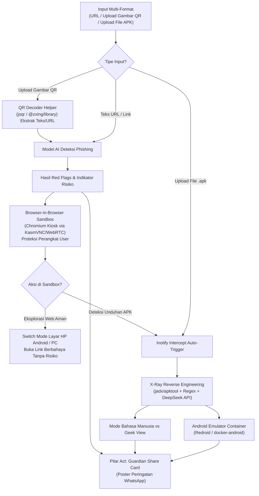

# Arsitektur Sistem, Alur Pengguna, & Pengaman Teknis — Guardian Lab

> **Dokumen:** `ai-agent-docs/system-architecture.md`  
> **Fokus Utama:** Alur Pengguna End-to-End (Tahap 1–5), Diagram Arsitektur, Safeguards Anti-Loophole, dan Komponen Tech Stack  
> **Audience:** AI Coding Agent, System Architect, & Fullstack Developer

---

## 1. Alur Pengguna End-to-End (Zero-Loophole User Journey)

Alur sistem dirancang berkesinambungan dari deteksi ringan hingga isolasi penuh tanpa celah logika maupun risiko infeksi pada perangkat pengguna:

### Tahap 1: Input Multi-Format (URL, QR Code, atau File `.apk`)

- **Input URL:** Pengguna menempelkan tautan mencurigakan yang ingin diperiksa.
- **Upload / Scan Gambar QR:** Berfungsi sebagai _utility helper_. Jika pengguna menerima gambar kode QR (misal dari chat WA atau poster), sistem langsung mendekode gambar tersebut menjadi teks/URL secara otomatis agar pengguna tidak perlu repot memindai dengan HP lalu mengetik/paste manual ke website.
- **Upload File `.apk`:** Pengguna mengunggah langsung file aplikasi Android yang mencurigakan (_drag-and-drop_ atau _file picker_). Sampel malware untuk keperluan pengujian demo/juri disediakan secara terpisah oleh tim.

### Tahap 2: Deteksi Garis Depan oleh Model AI Kustom

- Fitur leksikal URL/domain dianalisis (panjang host, _entropy_, _typosquatting_ nama bank/instansi/e-wallet Indonesia, TLD mencurigakan seperti `.xyz`, `.top`, `.click`, usia domain WHOIS, dan visual halaman).
- Menampilkan **Indikator Risiko Awal** (_Rendah / Mencurigakan / Indikasi Kuat Phishing_), daftar alasan (_Explainable Red Flags_), dan tombol **"Buka Aman di Browser Sandbox"**.

### Tahap 3: Eksplorasi Terisolasi di "Browser-in-Browser" (Proteksi Perangkat)

- Pengguna membuka tautan di dalam **Containerized Cloud Browser (Chromium Kiosk via WebRTC/KasmVNC)** yang berjalan di server terisolasi.
- **Fungsi Utama:** Murni memberikan rasa aman bagi pengguna untuk membuka dan memeriksa situs web yang terindikasi phishing/berbahaya tanpa perlu khawatir perangkat lokal mereka terkena malware atau dieksploitasi _browser exploit_.
- Fitur pendukung: **Switch Desktop Mode vs Layar HP Android (_Mobile User-Agent Spoofing_)** untuk membuka trik situs phishing yang hanya mau tampil di perangkat mobile.

### Tahap 4: Jembatan Otomatis (_Auto-Intercept APK_) ke Reverse Engineering & Emulator

- Direktori `Downloads` di dalam sandbox dipantau via `inotify`. Jika situs yang dibuka mencoba mengunduh file `.apk` (atau jika pengguna mengunggah file `.apk` secara manual), sistem langsung mengkarantina file tersebut.
- **Jalur Cepat (Reverse Engineering + DeepSeek LLM):** `jadx`/`apktool` mengekstrak `AndroidManifest.xml`, permissions, dan strings (Token Bot Telegram `api.telegram.org/bot...` & Nomor WA pelaku), lalu dikirim ke **DeepSeek API** untuk disajikan dalam **Mode Bahasa Manusia** dan **Mode Teknis (Geek View)**. Lihat spesifikasi kontrak di [api-and-prompts.md](./api-and-prompts.md).
- **Jalur Eksplorasi Interaktif:** Pengguna dapat membuka **"Instal & Jalankan APK di HP Virtual"** (`Redroid` / `docker-android`).

### Tahap 5: Penutup Alur — Pilar _Act_ (Guardian Share Card)

- **Guardian Share Card:** Generator infografis ringkas berisi tangkapan layar ber-watermark aman + 3 tanda bahaya utama yang siap diunduh (PNG) untuk dibagikan sebagai peringatan dini ke grup WhatsApp keluarga atau komunitas.

---

## 2. Pengaman Teknis & Penutup Celah (_Anti-Loophole Safeguards_)

| Potensi Celah                                                           | Solusi Rekayasa Wajib                                                                                                                                                                                                                                                                                                              |
| :---------------------------------------------------------------------- | :--------------------------------------------------------------------------------------------------------------------------------------------------------------------------------------------------------------------------------------------------------------------------------------------------------------------------------- |
| **1. Output Reverse Engineering Terlalu Rumit bagi Pengguna Awam**      | Sediakan _toggle_ **Mode Bahasa Manusia (Default)** vs **Mode Teknis (Geek View)**. DeepSeek menerjemahkan izin teknis (misal `RECEIVE_SMS`) menjadi dampak nyata (_"Aplikasi ini bisa membaca SMS OTP m-banking kamu"_), serta kartu sorotan **"Kedok Penipu Terbongkar"** (ID Bot Telegram/URL C2 hasil ekstraksi).              |
| **2. Risiko Perangkat Pengguna Terinfeksi saat Membuka Link Berbahaya** | Browser Sandbox (Chromium Kiosk) dijalankan 100% terisolasi di sisi server dalam kontainer Docker. Tidak ada eksekusi kode berbahaya di browser lokal klien.                                                                                                                                                                       |
| **3. Beban Server & Pengujian Emulator**                                | 1. Gunakan **Browser-in-Browser (Chromium Kiosk)** ringan (~300 MB RAM, boot < 2 detik) untuk web penjelajahan. 2. Gunakan **Pre-warmed Android Container (`Redroid` / `docker-android`)** yang standby khusus untuk instalasi `.apk` dengan _session timer_ 180 detik & pembersihan otomatis (`adb uninstall`).                |
| **4. Kepatuhan Batasan Keamanan & Privasi**                             | 1. Tambahkan modul **PII Scrubber (Regex Masking)** sebelum mengirim prompt ke DeepSeek API. 2. Tampilkan badge transparansi **"Powered by Custom AI + DeepSeek API (Data Anonim)"**. 3. Sampel file malware untuk pengujian disiapkan secara terpisah oleh tim agar tidak ada malware yang tersimpan bebas di landing page. |

---

## 3. Komponen Tech Stack Aplikasi

Aplikasi Guardian Lab dibangun dengan arsitektur **Fullstack Next.js (App Router / TypeScript / Bun)** yang menyatukan antarmuka pengguna dan seluruh backend API Route Handlers dalam satu kesatuan kode yang efisien:

- **Frontend & UI Layer (Next.js 16 / TypeScript):**
  - App Router dengan React Server Components (RSC) & Client Components (RCC).
  - Tailwind CSS v4, Lucide Icons, dan komponen primitif terstandarisasi shadcn UI.
  - `html-to-image` untuk rendering kartu peringatan _Guardian Share Card_ di sisi klien.
- **Backend API Route Handlers & Services (Next.js Fullstack):**
  - **QR Decoder Engine:** Ekstraksi teks/URL dari gambar QR menggunakan library JavaScript mature (`jsqr` / `@zxing/library`).
  - **Leksikal Phishing Classifier:** Mesin analisis leksikal native TypeScript (Shannon entropy, Levenshtein distance untuk deteksi typosquatting domain brand/e-wallet Indonesia, pemetaan pola URL berisiko).
  - **APK X-Ray Pipeline:** Dekompilasi manifest & ekstraksi strings via CLI `jadx` / `apktool` yang dijalankan melalui child process di Server Handler + Regex C2 Extractor.
  - **Integrasi LLM:** DeepSeek API (`deepseek-chat`) via SDK OpenAI-compatible dengan _structured JSON schema_.
  - **Orkestrasi Docker Sandbox:** Manajemen siklus sesi kontainer terisolasi (Chromium KasmVNC & Android Redroid) melalui Docker Engine API via socket `/var/run/docker.sock` menggunakan library `dockerode`.

> [!NOTE]
> Untuk rincian konfigurasi kontainer Docker (_Web Sandbox Chromium KasmVNC_, _Android Redroid Emulator_, port mapping, dan mount volume `/downloads`), silakan merujuk langsung ke dokumen resmi [deployment.md](./deployment.md).
